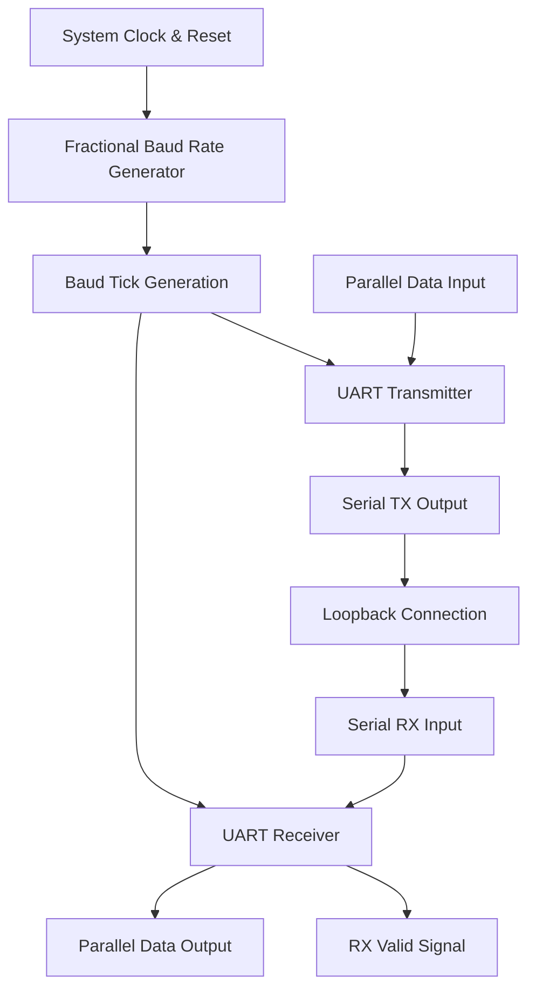

# UART High-Throughput IP Core

### Design and Optimization of a High-Throughput, Low-Latency UART Architecture

**Bangalore Institute of Technology | Department of ECE | Major Project 2026**

---

## Overview

This project focuses on the design, optimization, verification, and physical implementation of a high-performance UART (Universal Asynchronous Receiver-Transmitter) IP Core using Verilog HDL and open-source EDA tools.

The design integrates a UART transmitter, receiver, fractional baud-rate generator, FIFO-based data buffering, and internal loopback functionality.

A fractional phase accumulator is used to generate accurate baud-rate timing pulses, while the receiver employs 16× oversampling for reliable data sampling.

The project also explores hardware verification, Design for Testability (DFT), RTL synthesis, and ASIC physical design targeting the SkyWater SKY130 HD technology.

### Key Features

| Feature | Description |
|---|---|
| UART Transmitter | Converts parallel data into serial data |
| UART Receiver | Reconstructs parallel data from serial input |
| Baud Generator | Fractional phase-accumulator-based timing generation |
| Oversampling | 16× receiver oversampling |
| Data Buffering | FIFO-based TX/RX buffering |
| Loopback | Internal TX-to-RX communication testing |
| Verification | RTL simulation using Icarus Verilog |
| Waveform Analysis | GTKWave |
| Logic Synthesis | Yosys |
| Physical Design | OpenROAD-based ASIC implementation |
| Technology | SkyWater SKY130 HD |
| Toolchain | Open-source EDA tools |

---
## Repository Structure

```
uart-ip/
├── rtl/                  # Synthesizable Verilog RTL
│   ├── baud_gen.v        # Fractional baud rate generator
│   ├── uart_tx.v         # Transmitter FSM
│   ├── uart_rx.v         # Receiver FSM (16x oversampling)
│   ├── uart_fifo.v       # Parameterized synchronous FIFO
│   └── uart_top.v        # APB/Wishbone register-mapped top-level
├── tb/                   # Testbenches
│   ├── tb_uart_loopback.v   # Self-checking loopback (all baud + parity modes)
│   ├── tb_uart_fifo.v       # FIFO unit tests
│   ├── tb_baud_gen.v        # Baud generator accuracy tests
│   └── tb_uart_top.v        # APB register interface tests
├── syn/                  # Synthesis
│   ├── synth.ys             # Yosys synthesis script (Sky130 PDK)
│   └── sta.tcl              # OpenSTA timing analysis script
├── formal/               # Formal verification (SymbiYosys)
│   ├── uart_tx_formal.sby
│   └── uart_rx_formal.sby
├── scripts/              # Python analysis scripts
│   ├── ber_sweep.py         # BER + throughput characterization
│   └── area_sweep.py        # FIFO depth × oversampling trade-off sweep
├── sim/                  # Simulation outputs (gitignored)
├── docs/                 # Documentation and generated plots
│   └── TOOLCHAIN_SETUP.md
├── Makefile              # Build system
└── README.md
```
## System Architecture

The proposed UART IP Core consists of multiple functional blocks working together to enable reliable serial communication.

### Architecture Overview



### Functional Blocks

| Module | Function |
|---|---|
| Baud Rate Generator | Generates timing pulses using a fractional phase accumulator. |
| UART Transmitter | Converts parallel data into serial data using an FSM. |
| UART Receiver | Detects the start bit and reconstructs received data. |
| Synchronizer | Synchronizes the asynchronous RX input to the system clock. |
| Loopback | Connects TX output to RX input for internal testing. |

### Working Principle

1. **Clock and Reset:** The system clock provides the timing reference, while reset initializes the internal registers.
2. **Baud Generation:** The fractional baud-rate generator produces timing pulses required for UART transmission and reception.
3. **Transmission:** The transmitter accepts parallel data and converts it into a serial frame consisting of start, data and stop bits.
4. **Reception:** The receiver detects the incoming start bit, samples the data using 16× oversampling and reconstructs the original byte.
5. **Loopback Testing:** The transmitted serial output can be connected internally to the receiver to verify end-to-end communication.

The architecture is designed to support modular development, independent verification and future integration into larger digital systems.

---
## Fractional Baud Rate Generator

### Motivation

A conventional integer baud-rate generator uses a fixed clock divider to generate baud-rate timing pulses.

However, the required clock division ratio is not always an integer. Rounding the division factor can introduce baud-rate timing errors.

To overcome this limitation, this project uses a **32-bit fractional phase accumulator** for baud-rate generation.

### Working Principle

The fractional baud-rate generator continuously accumulates a fixed phase increment on every system clock cycle.

Its operation involves:

1. A 32-bit phase accumulator stores the current phase value.
2. A fixed phase increment is added to the accumulator on every clock cycle.
3. When the addition exceeds the 32-bit range, an overflow carry is generated.
4. This carry produces a baud-rate timing pulse.
5. The average frequency of these pulses is controlled by the phase increment.

### Mathematical Representation

The phase increment is calculated using:

\[
INC = \frac{F_{tick}}{F_{clk}} \times 2^{32}
\]

Where:

- \(INC\) = Phase increment value
- \(F_{tick}\) = Required baud tick frequency
- \(F_{clk}\) = System clock frequency

For 16× oversampling:

\[
F_{tick} = 16 \times BaudRate
\]

The accumulator generates timing pulses according to:

\[
Phase_{next} = Phase_{current} + INC
\]

Whenever an overflow occurs, a baud tick is generated.

### Simplified RTL Representation

```verilog
wire [32:0] phase_sum;

assign phase_sum = {1'b0, phase_acc} + {1'b0, phase_inc};

always @(posedge clk or posedge reset) begin
    if (reset) begin
        phase_acc <= 32'd0;
        baud_tick <= 1'b0;
    end
    else begin
        phase_acc <= phase_sum[31:0];
        baud_tick <= phase_sum[32];
    end
end
```

*Note: This is a simplified representation of the phase-accumulator principle.*

### Example: 9600 Baud Rate

Assuming a 50 MHz system clock:

\[
F_{clk} = 50\,MHz
\]

\[
BaudRate = 9600
\]

For 16× oversampling:

\[
F_{tick} = 9600 \times 16
\]

\[
F_{tick} = 153600\,Hz
\]

Therefore, the baud generator produces an average timing frequency of approximately 153.6 kHz.

### Advantages

- Supports fractional clock division ratios.
- Provides accurate average baud-rate timing.
- Reduces timing error associated with fixed integer division.
- Supports 16× receiver oversampling.
- Uses a simple digital accumulator architecture.

---
## UART Transmitter and Receiver Architecture

The UART IP Core consists of two major functional blocks: the Transmitter (TX) and Receiver (RX).

The transmitter converts parallel data into a serial bit stream, while the receiver reconstructs the original parallel data from the incoming serial stream.

### 1. UART Transmitter (TX)

The transmitter accepts 8-bit parallel data and converts it into a serial UART frame.

It follows the standard UART frame structure:

- 1 Start Bit
- 8 Data Bits
- 1 Stop Bit

Data is transmitted in Least Significant Bit (LSB) first order.

#### Transmitter FSM

The transmitter is implemented using a Finite State Machine (FSM) consisting of four states:

| State | Function |
|---|---|
| IDLE | Waits for a transmission request. |
| START | Generates the start bit (logic LOW). |
| DATA | Transmits the 8 data bits sequentially. |
| STOP | Generates the stop bit (logic HIGH). |

#### Transmitter Operation

1. The transmitter waits in the IDLE state until data transmission is requested.
2. It enters the START state and drives the TX line LOW.
3. It enters the DATA state and transmits all eight bits, starting from the LSB.
4. Each data bit is maintained for the required bit period.
5. Finally, the transmitter enters the STOP state and drives the TX line HIGH.
6. The FSM returns to IDLE after completing transmission.

The transmitter uses 16 baud ticks per bit to match the timing scheme used by the receiver.

### 2. UART Receiver (RX)

The receiver accepts serial data and reconstructs the original 8-bit parallel data.

It uses 16× oversampling to identify and sample incoming data near the centre of each bit period.

#### Receiver FSM

The receiver operates through four main states:

| State | Function |
|---|---|
| IDLE | Waits for an incoming start bit. |
| START | Detects and confirms the start bit. |
| DATA | Samples and stores the received data bits. |
| STOP | Checks the stop bit and completes reception. |

#### Receiver Operation

1. The receiver continuously monitors the incoming RX line.
2. A LOW transition indicates a possible start bit.
3. The receiver synchronizes the asynchronous input using a two-flip-flop synchronizer.
4. It confirms the start bit and begins sampling the incoming data.
5. The eight data bits are sampled near their respective bit centres.
6. The received bits are assembled into an 8-bit parallel data word.
7. After checking the stop bit, the receiver asserts the `rx_valid` signal to indicate successful reception.

### 3. Asynchronous Input Synchronization

Since UART communication does not use a shared clock between the transmitter and receiver, the incoming RX signal is asynchronous to the internal system clock.

Directly sampling an asynchronous signal can introduce metastability.

To reduce this risk, the receiver uses a two-flip-flop synchronizer.

This improves the reliability of signal sampling before the receiver processes the incoming data.

### 4. TX-RX Communication

The transmitter and receiver work together to establish serial communication.

In internal loopback mode, the TX output is connected directly to the RX input.

This allows the complete transmission and reception path to be tested without requiring an external communication device.

---
## FIFO Architecture and Data Buffering

### What is a FIFO?

FIFO stands for First In, First Out.

It is a data-buffering structure in which the first data item written into the buffer is the first one to be read.

### Why is FIFO Required in UART?

During serial communication, data transmission and reception may happen independently of the processor's ability to process data.

A FIFO provides temporary storage, helping manage differences between data production and consumption rates.

### Basic FIFO Operation

A FIFO generally uses two pointers:

- **Write Pointer:** Identifies the location where incoming data is stored.
- **Read Pointer:** Identifies the location from which data is retrieved.

It also uses status signals:

| Signal | Function |
|---|---|
| Write Enable | Enables writing data into the FIFO |
| Read Enable | Enables reading data from the FIFO |
| Full | Indicates that the FIFO cannot accept additional data |
| Empty | Indicates that no data is available for reading |

### UART Integration

In a UART architecture, buffering can be provided at two locations:

**TX FIFO:** Temporarily stores parallel data before it is transmitted serially.

**RX FIFO:** Stores received parallel data until the processor or external interface reads it.

### Benefits

- Reduces the possibility of data loss when the processor cannot immediately service incoming data.
- Maintains the order of transmitted and received data.
- Provides temporary storage between communication and processing blocks.
- Supports more efficient data handling.

---
## Functional Verification and Simulation

Functional verification is an essential stage in digital hardware development. It ensures that the designed RTL behaves according to the intended specifications.

The UART IP Core uses an open-source simulation and verification environment.

### Tools Used

| Tool | Purpose |
|---|---|
| Icarus Verilog | RTL compilation and simulation |
| GTKWave | Simulation waveform visualization |
| Verilator | RTL linting and design checks |

### Verification Methodology

The verification process involves testing individual functional blocks as well as the integrated UART architecture.

The major verification scenarios include:

**1. Transmitter Verification**

- Checks UART frame generation.
- Verifies start and stop bits.
- Checks LSB-first data transmission.
- Verifies bit timing.

**2. Receiver Verification**

- Checks start-bit detection.
- Verifies data sampling.
- Checks reconstruction of received data.
- Observes the receiver valid signal.

**3. Baud Generator Verification**

- Checks phase accumulator operation.
- Observes baud-tick generation.
- Evaluates timing behaviour.

**4. FIFO Verification**

- Checks write and read operations.
- Verifies data ordering.
- Tests full and empty conditions.

**5. Loopback Verification**

The internal loopback configuration connects the transmitter output directly to the receiver input.

This allows end-to-end communication testing within the UART architecture.

### Simulation Workflow

The simulation process follows these stages:

1. Write the Verilog RTL modules.
2. Develop suitable Verilog testbenches.
3. Compile the design using Icarus Verilog.
4. Execute the simulation.
5. Generate waveform data.
6. Inspect signal transitions using GTKWave.
7. Analyse the results against the expected behaviour.

### Available Makefile Commands

```bash
# Run the main simulation
make sim

# Run a specific testbench
make tb TB=tb_uart_loopback

# Run FIFO testbench
make tb TB=tb_uart_fifo

# Run baud generator testbench
make tb TB=tb_baud_gen

# Run top-level testbench
make tb TB=tb_uart_top

# View simulation waveforms
make wave

# Perform RTL linting
make lint
```

### Verification Objective

The objective is to establish functional correctness, identify design errors and ensure reliable communication between the transmitter and receiver.

Simulation waveforms provide visibility into internal signal behaviour, making debugging and design validation easier.

---
## Design for Testability (DFT)

Design for Testability (DFT) refers to techniques used in digital circuit design to make manufactured hardware easier to test for potential defects.

In complex digital systems, accessing internal registers and signals directly can be difficult. DFT introduces additional test structures that improve internal controllability and observability.

### Scan Chain Architecture

A scan chain is a commonly used DFT technique in which flip-flops are connected together to form a shift-register structure during test mode.

It allows test data to be shifted into internal registers and the resulting data to be shifted out for observation.

### Scan Register Implementation

The project includes a standalone 16-bit scan-register structure to demonstrate basic scan-based testing.

The structure supports:

- Scan Input (SI)
- Scan Output (SO)
- Test Mode Control
- Parallel Data Input
- Parallel Data Output
- Fault-Injection Control

### Operating Modes

**1. Normal Mode**

In normal operation, the register loads parallel input data and provides parallel output data.

**2. Scan Mode**

When test mode is enabled, data is shifted through the register using the scan input.

The shifted data can be observed through the scan output.

### Fault Modelling

The project also explores stuck-at fault modelling.

A stuck-at fault occurs when a digital signal remains permanently at a particular logic value, regardless of the intended input.

Two common fault types are:

| Fault Type | Description |
|---|---|
| Stuck-at-0 (SA0) | Signal remains permanently at logic LOW. |
| Stuck-at-1 (SA1) | Signal remains permanently at logic HIGH. |

The documented test scenarios include 16 stuck-at-0 cases and 16 stuck-at-1 cases.

### Importance of DFT

- Improves internal circuit observability.
- Makes sequential elements easier to test.
---
## ASIC Physical Design Flow

The project explores the ASIC implementation flow, taking the UART design beyond RTL simulation towards physical chip implementation.

The target technology is the **SkyWater SKY130 Process Design Kit (PDK)**, an open-source 130 nm technology platform.

### What is RTL-to-GDS?

RTL-to-GDS is the process of converting a hardware description into a physical integrated circuit layout.

- **RTL Design:** Describes the functionality of the digital circuit.
- **Physical Design:** Converts the synthesized logic into physical standard cells and interconnections.
- **GDSII:** A standard file format used to represent the final integrated circuit layout.

### ASIC Implementation Stages

The typical RTL-to-GDS flow consists of the following stages:

**1. RTL Design**

The UART architecture is described using Verilog HDL. The design includes the transmitter, receiver, baud-rate generator and associated logic.

**2. Logic Synthesis**

Yosys converts the RTL description into a gate-level netlist.

The synthesis process maps the design to standard cells available in the target technology library.

**3. Floorplanning**

Floorplanning defines the physical dimensions of the chip core and die.

It establishes the initial physical layout area and prepares the design for placement.

**4. Placement**

The synthesized standard cells are positioned within the core area.

Placement considers factors such as timing, area and connectivity.

**5. Clock Tree Synthesis (CTS)**

CTS creates a clock distribution network to deliver the clock signal to sequential elements across the design.

It aims to control clock skew and insertion delay.

**6. Routing**

Routing creates the metal interconnections between standard cells according to the circuit netlist.

It completes the physical connectivity of the design.

**7. Static Timing Analysis (STA)**

STA evaluates the timing behaviour of the circuit by analysing its timing paths.

It checks setup and hold requirements against the specified clock constraints.

For a target clock frequency of 50 MHz:

\[
T = \frac{1}{50 \times 10^6} = 20\,ns
\]

Therefore, the timing analysis evaluates whether the design satisfies the 20 ns clock-period requirement.

**8. Physical Verification**

Two important physical verification checks are:

- **DRC (Design Rule Check):** Checks whether the layout follows the manufacturing design rules.
- **LVS (Layout Versus Schematic):** Checks whether the physical layout matches the intended circuit netlist.

**9. GDSII Generation**

After the required implementation and verification stages, the physical layout can be exported in GDSII format for fabrication-related use.

### Tools Used in the ASIC Flow

| Tool / Technology | Purpose |
|---|---|
| Yosys | RTL synthesis |
| SKY130 PDK | Target semiconductor technology |
| OpenROAD | Open-source physical-design infrastructure |
| OpenSTA | Static timing analysis |
| Magic | Layout inspection and physical verification |
| KLayout | IC layout viewing and inspection |
| Netgen | LVS comparison |

### Project Implementation Scope

The repository Makefile provides targets for:

- RTL synthesis using Yosys (`make synth`)
- Static timing analysis using OpenSTA (`make sta`)

The complete RTL-to-GDS process is described as the broader ASIC implementation flow. Individual physical-design stages should only be marked as completed when their corresponding implementation outputs and reports are available.

---
## Results and Performance Analysis

This section presents the reported functional and ASIC implementation results of the UART architecture.

### 1. Functional Results

| Feature | Reported Result |
|---|---|
| UART Transmitter | Implemented |
| UART Receiver | Implemented |
| Fractional Baud Generator | 32-bit phase accumulator |
| Receiver Oversampling | 16× |
| FIFO | Included in project architecture |
| Internal Loopback | Transmitted and received data matched |
| Scan Register | 16-bit scan operation |
| Modelled Fault Cases | 32 cases |

### Loopback Verification

The project documentation reports a successful internal loopback test.

**Transmitted Data:**
```text
0x88
```

**Received Data:**
```text
0x88
```

The matching transmitted and received values demonstrate successful end-to-end communication for this test case.

### 2. ASIC Implementation Results

The following figures are the reported implementation results for the SKY130 technology.

| Parameter | Reported Result |
|---|---:|
| Technology | SKY130 |
| Standard Cells | 1,319 |
| Sequential Cells | 397 |
| Core Area | 34,628.2 µm² |
| Die Area | 41,530.2 µm² |
| Core Utilization | 50.74% |
| Target Clock Frequency | 50 MHz |
| Worst Setup Slack | +7.463 ns |
| Total Power | 2.005 mW |
| Maximum Slew Violations | 363 |
| Maximum Fanout Violations | 13 |
| Maximum Capacitance Violations | 0 |
| DRC Errors | 0 |
| LVS Errors | 0 |

### 3. Area Analysis

The reported core area is:

**34,628.2 µm²**

Core area represents the physical area occupied by the standard-cell region of the design.

The reported die area is 41,530.2 µm², with a core utilization of 50.74%.

### 4. Timing Analysis

The target clock frequency is 50 MHz.

Therefore, the clock period is:

\[
T = \frac{1}{50 \times 10^6} = 20\,ns
\]

The reported worst setup slack is:

**+7.463 ns**

Positive setup slack indicates that the reported worst setup path meets the specified setup timing requirement.

However, the remaining slew and fanout violations indicate that further electrical and physical optimization is possible.

### 5. Power Analysis

The reported total power consumption is:

**2.005 mW**

The documented power breakdown is:

| Power Component | Reported Value |
|---|---:|
| Internal Power | 1.529 mW |
| Switching Power | 0.476 mW |
| Leakage Power | Approximately 0.000038 mW |

These values correspond to the reported analysis conditions and should not be assumed to represent every operating condition or process corner.

### 6. Physical Verification

The reported physical verification results are:

- DRC errors: 0
- LVS errors: 0
- Maximum capacitance violations: 0

However, the implementation also reports 363 maximum slew violations and 13 maximum fanout violations.

These violations represent opportunities for further optimization through buffering, fanout management and physical-design refinement.

### 7. Performance Summary

The reported results demonstrate:

- Successful UART loopback communication for the documented test case.
- Positive setup slack at the target 50 MHz clock.
- A reported core utilization of 50.74%.
- Total reported power of 2.005 mW.
- Zero reported DRC and LVS errors.
- Remaining slew and fanout violations that require further attention.

**Note:** These figures are taken from the project's documented results. They should be interpreted in the context of the specific implementation and analysis conditions.
---

## Challenges and Future Improvements

### 1. Challenges Encountered

During the development and integration of the UART architecture, several technical challenges were encountered.

**1. Baud Generator Interface Mismatch**

Different versions of the baud generator used different phase-increment widths, resulting in compatibility issues during module integration.

The interface and phase-increment width were standardized to resolve the mismatch.

**2. Incorrect Loopback Data**

Initially, the received data did not match the transmitted data.

The issue was related to the baud-generation and receiver-sampling relationship.

The timing relationship was corrected, and the project documentation reports the following loopback result:

```text
Transmitted Data: 0x88
Received Data:    0x88
```

**3. FIFO Verification**

FIFO operations required careful verification, particularly:

- Write operations
- Read operations
- Full-condition detection
- Empty-condition detection
- Sequential data storage and retrieval

Dedicated test scenarios were used to examine these operations.

**4. Introducing DFT Functionality**

Introducing test-mode functionality without disturbing normal operation was another challenge.

A separate scan-register structure with normal and test operating modes was used to demonstrate scan-based testing concepts.

**5. TX and RX Timing Mismatch**

The transmitter and receiver must maintain a compatible bit duration for reliable communication.

The transmitter holds each bit for 16 baud ticks, matching the receiver's 16-times sampling scheme.

---

### 2. Future Scope

Although the project demonstrates UART design, verification, DFT concepts and ASIC implementation, several improvements can be explored.

#### A. DFT Enhancements

- Integrate scan structures into the UART's sequential logic.
- Implement Automatic Test Pattern Generation (ATPG).
- Develop a more comprehensive stuck-at fault model.
- Evaluate and report validated fault coverage.

#### B. Timing Optimization

- Resolve the remaining maximum slew violations.
- Reduce maximum fanout violations.
- Improve standard-cell placement.
- Optimize buffering and clock distribution.

#### C. Power and Area Optimization

- Reduce unnecessary switching activity.
- Explore RTL-level architectural optimizations.
- Evaluate power consumption across different process, voltage and temperature (PVT) corners.
- Explore area-efficient circuit implementations.

#### D. Functional Enhancements

- Support additional baud rates.
- Introduce configurable data widths.
- Add configurable parity support.
- Improve framing-error and overrun detection.

#### E. Hardware-Level Validation

- Explore fabrication of the design using the target technology.
- Test the implemented design on actual hardware.
- Measure real-world communication performance.
- Evaluate power consumption, throughput and latency under practical operating conditions.

---

### 3. Conclusion

This project provides practical exposure to digital RTL design, UART communication, fractional baud-rate generation, functional verification, DFT concepts and ASIC physical-design workflows.

The implementation also highlights the importance of balancing performance, area, power and testability while designing digital systems.

The identified challenges and future improvements provide opportunities to further enhance the architecture and explore more advanced VLSI design techniques.
---

## Repository Structure

The project follows a modular directory structure to separate RTL design, verification, synthesis, physical-design scripts and documentation.

```text
uart-ip/
│
├── rtl/
│   ├── baud_gen.v
│   ├── uart_tx.v
│   ├── uart_rx.v
│   ├── uart_fifo.v
│   └── uart_top.v
│
├── tb/
│   ├── tb_uart_loopback.v
│   ├── tb_uart_fifo.v
│   ├── tb_baud_gen.v
│   └── tb_uart_top.v
│
├── syn/
│   ├── synth.ys
│   └── sta.tcl
│
├── formal/
│   ├── uart_tx_formal.sby
│   └── uart_rx_formal.sby
│
├── scripts/
│   ├── ber_sweep.py
│   └── area_sweep.py
│
├── sim/
│   └── Simulation outputs (generated)
│
├── docs/
│   └── TOOLCHAIN_SETUP.md
│
├── Makefile
├── README.md
├── LICENSE
└── .gitignore
```

### Directory Description

| Directory / File | Description |
|---|---|
| `rtl/` | Contains Verilog RTL modules for the UART architecture. |
| `tb/` | Contains testbenches for functional verification. |
| `syn/` | Contains Yosys synthesis and timing-analysis scripts. |
| `formal/` | Contains SymbiYosys formal verification configuration files. |
| `scripts/` | Contains Python scripts for performance and trade-off analysis. |
| `sim/` | Stores generated simulation outputs and waveform files. |
| `docs/` | Contains project documentation and toolchain setup instructions. |
| `Makefile` | Provides commands to automate simulation, linting, synthesis and analysis. |
| `README.md` | Provides project information, architecture and implementation details. |
| `LICENSE` | Defines the project's licensing terms. |
| `.gitignore` | Specifies generated files and directories excluded from Git tracking. |

**Note:** The directory tree describes the expected project layout based on the Makefile. Ensure the corresponding source files and scripts are present in the repository before publishing it as a fully runnable project.

---

## Quick Start

### 1. Install Tools

```bash
sudo apt install iverilog gtkwave yosys verilator
pip3 install symbiyosys matplotlib numpy
```

See [docs/TOOLCHAIN_SETUP.md](docs/TOOLCHAIN_SETUP.md) for full instructions.

### 2. Clone and Run

```bash
git clone https://github.com/<your-org>/uart-ip.git
cd uart-ip
make sim          # simulate and run loopback testbench
make wave         # view waveforms in GTKWave
make lint         # lint RTL with Verilator
make synth        # synthesize to Sky130 PDK
make formal       # run SymbiYosys SVA proofs
```

### 3. Check Tool Availability

Run:

```bash
make check-tools
```

This checks whether the required tools are available in your environment.

### 4. Run UART Simulation

To compile and execute the loopback testbench:

```bash
make sim
```

The Makefile uses Icarus Verilog for compilation and VVP to execute the generated simulation.

### 5. Run Individual Testbenches

The Makefile provides support for running individual testbenches:

**UART Loopback Test**
```bash
make tb TB=tb_uart_loopback
```

**FIFO Test**
```bash
make tb TB=tb_uart_fifo
```

**Baud Generator Test**
```bash
make tb TB=tb_baud_gen
```

**UART Top-Level Test**
```bash
make tb TB=tb_uart_top
```

These commands require the corresponding testbench files to be present in the `tb/` directory.

### 6. View Simulation Waveforms

GTKWave can be used to inspect signal transitions and understand the internal behaviour of the UART architecture.

```bash
make wave
```

The Makefile expects the waveform file at:

```text
sim/uart_sim.vcd
```

Ensure that the testbench generates the VCD file at this location before running the waveform command.

### 7. Run RTL Linting

Use Verilator to check the RTL design for potential coding issues:

```bash
make lint
```

### 8. Run Logic Synthesis

Use Yosys to synthesize the RTL design:

```bash
make synth
```

This target requires the synthesis script and the configured SKY130 standard-cell library.

### 9. Run Static Timing Analysis

To execute timing analysis using OpenSTA:

```bash
make sta
```

This requires the synthesized netlist and the corresponding timing-analysis configuration.

### 10. Clean Generated Files

To remove generated simulation and synthesis outputs:

```bash
make clean
```

### Build System Summary

| Command | Purpose |
|---|---|
| `make check-tools` | Check tool availability |
| `make sim` | Run loopback simulation |
| `make tb TB=<name>` | Run a selected testbench |
| `make wave` | Open GTKWave |
| `make lint` | Run Verilator linting |
| `make synth` | Run Yosys synthesis |
| `make sta` | Run static timing analysis |
| `make formal` | Run SymbiYosys formal checks |
| `make ber` | Run BER and throughput analysis script |
| `make sweep` | Run area/timing trade-off analysis script |
| `make regression` | Run lint, simulation and formal targets |
| `make clean` | Remove generated outputs |

**Note:** Each command depends on its corresponding source files, scripts, libraries and tool installations. Successful execution should be confirmed using the generated logs and reports.


```bash
make sim FIFO_DEPTH=32 BAUD_RATE=1000000
make sim FIFO_DEPTH=64 BAUD_RATE=10000000
```

---

## Register Map

| Offset | Name    | Bits  | Description |
|--------|---------|-------|-------------|
| 0x00   | CTRL    | [7:0] | `parity_en`, `parity_odd`, `stop_bits`, `tx_en`, `rx_en` |
| 0x04   | STATUS  | [7:0] | `tx_busy`, `rx_valid`, `framing_err`, `parity_err`, `overrun_err`, `noise_err`, `tx_full`, `rx_empty` |
| 0x08   | DATA    | [7:0] | Write → TX FIFO, Read → RX FIFO |
| 0x0C   | BAUD    |[15:0] | Runtime baud divisor |

---


---

## Expected Outcomes

- ✅ Baud rates up to 10 Mbps (100× over baseline)
- ✅ Zero data loss under CPU load (hardware FIFO)
- ✅ Formal proof: no TX corruption, FSM liveness, FIFO safety
- ✅ Quantified area/timing curves via Yosys + Sky130
- ✅ Drop-in SoC integration via APB/Wishbone

---


## License

MIT License — see [LICENSE](LICENSE)
